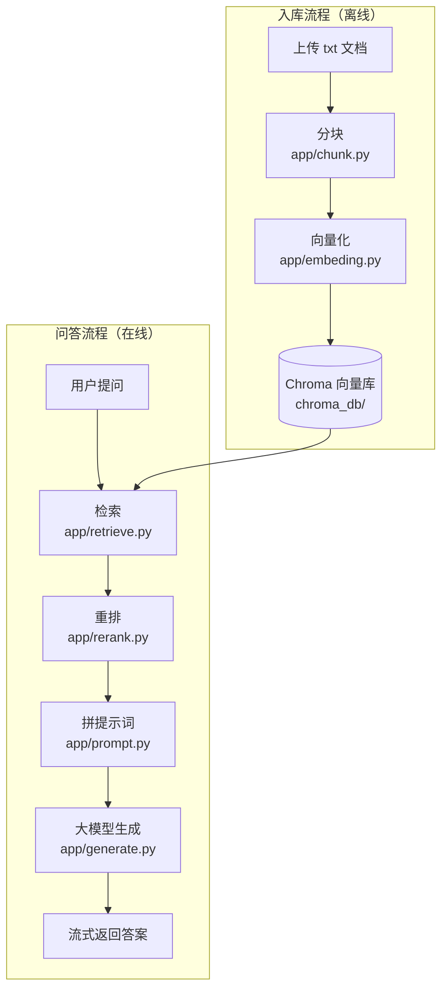

# knowledge-rag-assistant

基于电商行业的 RAG（检索增强生成）知识库问答助手：上传文档后，能够基于文档内容回答用户的提问
（适用于电商企业/个人）。

## 功能特性

- 上传 txt 文档，自动切块、向量化、入库
- 基于文档内容回答问题，答案标明出处（参考了哪个文件）
- 流式输出：AI 逐字返回答案，不用干等
- 重排（Rerank）：让 AI 给检索结果二次打分，答案更准

## 架构


## 技术栈

| 层 | 技术 |
|---|---|
| 后端框架 | FastAPI + Uvicorn |
| 向量数据库 | ChromaDB（本地持久化） |
| Embedding 模型 | bge-m3（SiliconFlow API） |
| 大语言模型 | DeepSeek（SiliconFlow API） |
| 前端 | 原生 HTML + JS |

## 目录结构

```
knowledge-rag-assistant/
├── app/
│   ├── chunk.py        # 文档切块
│   ├── embeding.py     # 文本转向量
│   ├── data_storage.py # 向量入库
│   ├── retrieve.py     # 检索
│   ├── rerank.py       # 重排
│   ├── prompt.py       # 提示词组装
│   └── generate.py     # 大模型生成
├── data/               # 知识库原始文档（txt）
├── chroma_db/          # 向量库本地存储
├── index.html          # 前端聊天页面
├── main_fast_api.py    # FastAPI 入口
└── requirements.txt    # 依赖清单
```

## 快速开始

**1. 安装依赖**

```bash
pip install -r requirements.txt
```

**2. 配置密钥**

在项目根目录建 `.env` 文件：

```
SF_API_KEY=你的SiliconFlow密钥
```

**3. 启动服务**

```bash
python main_fast_api.py
```

**4. 打开浏览器**

访问 http://localhost:8000/chat
